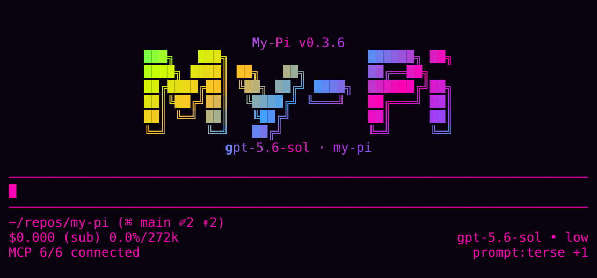

# my-pi

[](https://github.com/spences10/my-pi/actions/workflows/semgrep.yml)
[](https://viteplus.dev)
[](https://vitest.dev)

`my-pi` is my [Pi](https://pi.dev): upstream Pi with my extensions
built in. Each extension is also published on its own.



## Use

```bash
pnpx --allow-build=@google/genai --allow-build=protobufjs my-pi@latest
```

Turn extensions on or off with `/extensions`. Or install single
packages into your own Pi:

```bash
pi install npm:@spences10/pi-lsp
```

MCP, codemode, tool search, skills, themes, sessions, and package
configuration are upstream Pi features. See the
[Pi docs](https://pi.dev).

## Packages

| Package                                                                            | Purpose                                                    |
| ---------------------------------------------------------------------------------- | ---------------------------------------------------------- |
| [`my-pi`](./packages/my-pi/README.md)                                              | My Pi: upstream Pi with all of these built in              |
| [`@spences10/pi-coding-preferences`](./packages/pi-coding-preferences/README.md)   | Configurable coding-workflow guardrails                    |
| [`@spences10/pi-confirm-destructive`](./packages/pi-confirm-destructive/README.md) | Destructive action confirmations                           |
| [`@spences10/pi-context`](./packages/pi-context/README.md)                         | Scoped SQLite FTS overflow cache for oversized tool output |
| [`@spences10/pi-codex-usage`](./packages/pi-codex-usage/README.md)                 | OpenAI Codex usage in the footer status area               |
| [`@spences10/pi-footer`](./packages/pi-footer/README.md)                           | Configurable footer status line                            |
| [`@spences10/pi-git-ui`](./packages/pi-git-ui/README.md)                           | Interactive source-control staging UI                      |
| [`@spences10/pi-harness`](./packages/pi-harness/README.md)                         | Ephemeral task harness runtime                             |
| [`@spences10/pi-kimi-usage`](./packages/pi-kimi-usage/README.md)                   | Kimi For Coding usage in the footer status area            |
| [`@spences10/pi-lsp`](./packages/pi-lsp/README.md)                                 | LSP-backed diagnostics and symbol tools                    |
| [`@spences10/pi-observability`](./packages/pi-observability/README.md)             | Live local event stream and browser dashboard              |
| [`@spences10/pi-recall`](./packages/pi-recall/README.md)                           | `pirecall` reminder and background sync                    |
| [`@spences10/pi-redact`](./packages/pi-redact/README.md)                           | Output redaction and `/redact-stats`                       |
| [`@spences10/pi-starfield`](./packages/pi-starfield/README.md)                     | Input stars and a suggested next prompt (Tab)              |
| [`@spences10/pi-svelte-guardrails`](./packages/pi-svelte-guardrails/README.md)     | Svelte pattern guardrails                                  |
| [`@spences10/pi-talk`](./packages/pi-talk/README.md)                               | Hold-Space Deepgram dictation                              |
| [`@spences10/pi-team-mode`](./packages/pi-team-mode/README.md)                     | Peer-session coordination and durable mailboxes            |
| [`@spences10/pi-telemetry`](./packages/pi-telemetry/README.md)                     | Local SQLite telemetry and `/telemetry`                    |
| [`@spences10/pi-themes`](./packages/pi-themes/README.md)                           | Bundled theme pack for Pi                                  |

Support libraries (dependencies, not for `pi install`):
`pi-child-env`, `pi-project-trust`, `pi-settings`, `pi-sqlite-core`,
`pi-tui-modal`. See [`docs/package-map.md`](./docs/package-map.md).

## Develop

Requires Node.js `>=24.15.0` and pnpm.

```bash
pnpm install
pnpm run build
pnpm start            # node packages/my-pi/dist/index.js
pnpm run check
pnpm run test
```

```text
apps/web/      Landing page
packages/      my-pi launcher and pi-* packages
evals/         Smoke eval suite (pnpm run eval:suite)
.agents/skills Repository skills for agents working here
```
