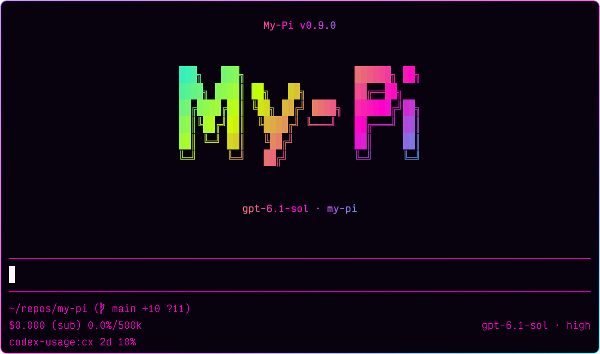

# @spences10/pi-ask-user

<!-- package-readme:header:start -->

[](https://viteplus.dev)
[](https://vitest.dev)
[](https://www.npmjs.com/package/@spences10/pi-ask-user)
[](https://www.npmjs.com/package/@spences10/pi-ask-user)



<!-- package-readme:header:end -->

Optional questionnaires for choosing from a concrete list, without
turning the conversation into an approval gate. The
`ask_user_question` tool supports a single list or several question
tabs, with optional category tabs inside each question.

## Install

<!-- package-readme:install:start -->

```bash
pi install npm:@spences10/pi-ask-user
```

<!-- package-readme:install:end -->

Bundled into my-pi as `ask-user`. Disable it with
`/extensions disable ask-user`; changes apply on reload. Disable any
older extension registering `ask_user_question` so only one
implementation is loaded.

## Answer or talk instead

- **Type to search** labels and descriptions; no `/` prefix is needed.
  **Ctrl+F** opens the existing filter for editing. **Enter** applies
  it; **↑/↓** returns to list navigation. Space is ordinary text while
  editing a filter, and toggles choices when navigating the list.
- **↑/↓** navigates; long lists scroll. **Space** toggles multiselect
  choices. **Enter** on a choice submits all checked choices, or that
  one choice for single-select. In a batch it saves that answer and
  advances to the next question or review, without submitting yet.
- **Alt+←/→** switches category tabs. All shows the complete list;
  uncategorized choices have their own tab when categories are
  present. Selections survive filtering and category changes. The
  header counts selected choices hidden by the current view.
- **←/→** or **Tab / Shift+Tab** switches questions and the review
  screen in a batch. While editing text, arrows move the cursor
  instead; Tab / Shift+Tab still switches questions and saves current
  edits. Each question retains its own filter, category, selections,
  Other text and comment.
- **Alt+C** edits a comment alongside the answer, for example “these
  projects, but only check dependencies.” Bare `c` remains searchable.
- **Alt+O** edits Other text. Multiselect keeps checked choices and
  custom text together. For single-select, saving nonempty Other text
  submits that answer, or advances in a batch. Bare `o` is searchable.
- **Enter** saves a comment or multiselect Other text and returns to
  the list. Review shows the complete batch, including unanswered
  questions; **↑/↓** or **PageUp/PageDown** scrolls and **Enter**
  submits. You can revisit questions before submitting.
- **Esc** while editing discards that edit and returns to the list.
  **Esc** from a list or review dismisses the whole questionnaire,
  stops the current run and returns to chat without an automatic model
  follow-up.

Other, Comment, and Submit/Next also appear as navigable rows. For a
single question, write a comment before making a single-select choice.
Text fields use Pi's single-line input editing, including Ctrl+U to
clear back to the start.

Dismissal submits neither draft selections nor comments. It means “let
me talk instead,” not “reject the task.” The tool's model guidance
asks it to use questionnaires for concrete selections, not to force
exploration into a menu or immediately re-ask a dismissed question.

## Single lists, categories and question tabs

Add `category` to options to group one decision. Categories appear in
first-seen order; omit them for a plain list:

```json
{
	"question": "Which projects?",
	"multiSelect": true,
	"options": [
		{ "label": "website", "category": "Frontend" },
		{ "label": "console", "category": "Frontend" },
		{ "label": "orders-api", "category": "Backend" }
	]
}
```

Use `questions` instead of the top-level single-question fields for
separate decisions. Each question can independently use categories,
multiselect, Other and a comment. `header` optionally names its tab:

```json
{
	"questions": [
		{
			"header": "Projects",
			"question": "Which projects?",
			"multiSelect": true,
			"options": [
				{ "label": "website", "category": "Frontend" },
				{ "label": "orders-api", "category": "Backend" }
			]
		},
		{
			"header": "Checks",
			"question": "Which checks?",
			"multiSelect": true,
			"options": [{ "label": "Types" }, { "label": "Tests" }]
		}
	]
}
```

The `questions` form always includes review, even with one question.
There is no fixed maximum number of questions, categories or options;
tab strips keep the active tab visible on narrow terminals. Untouched
questions can be left unanswered, rather than forcing a choice.

## Results and limits

Successful answers keep selected labels in the original list order:

```json
{
	"cancelled": false,
	"answers": ["project-a", "project-c"],
	"comment": "Only check dependencies"
}
```

`other` and `comment` appear only when nonempty. Explicitly submitting
no choices returns an empty `answers` array; this is not cancellation
or approval for unrelated work.

The `questions` form returns `cancelled: false` and `responses`, one
entry per question with its zero-based `questionIndex`, `question`,
and `status`. An `answered` entry contains `answer` in the single-list
shape above; an `unanswered` entry has no `answer`. Checking or
unchecking a choice, saving text, or explicitly saving an empty answer
counts as answering; merely browsing or searching does not. Comments
remain qualifications, not approval for unselected work.

Tool details distinguish `answered`, `dismissed`, `aborted`, and
`unavailable` states. Submitted answers and comments are stored in the
normal session history, not a separate preferences database.

The custom picker requires a TUI. RPC, print, and JSON modes return an
unavailable result asking the model to use plain chat instead; this
does not claim the user declined. There is no worker forwarding,
dashboard, or automatic reuse of previous answers.

## Development

<!-- package-readme:development:start commands="check,test,build" -->

Package scripts build transitive workspace dependencies first, then
run local tools through Vite+ with `vp exec`.

```bash
pnpm --filter @spences10/pi-ask-user run check
pnpm --filter @spences10/pi-ask-user run test
pnpm --filter @spences10/pi-ask-user run build
```

<!-- package-readme:development:end -->

### Try local changes

From the my-pi repository, build the package and start the launcher:

```bash
pnpm --filter @spences10/pi-ask-user run build
pnpm start
```

For standalone Pi, build the package and install its local directory:

```bash
pi install /path/to/my-pi/packages/pi-ask-user
```

For standalone Pi, use `/reload` after rebuilding the package. For the
bundled my-pi version, restart `pnpm start` after rebuilding; its
imported extension factory remains cached within the process.

## License

MIT
