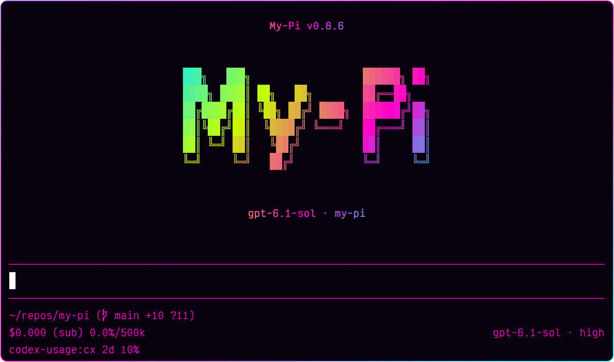

# @spences10/pi-observability

<!-- package-readme:header:start -->

[](https://viteplus.dev)
[](https://vitest.dev)
[](https://www.npmjs.com/package/@spences10/pi-observability)
[](https://www.npmjs.com/package/@spences10/pi-observability)



<!-- package-readme:header:end -->

Live local observability for Pi sessions. When enabled, the extension
auto-starts a local server, streams redacted lifecycle events to it,
and serves a browser dashboard with overview, sessions, tools, and
per-session trace views, updated live over Server-Sent Events.

## Installation

<!-- package-readme:install:start -->

```bash
pi install npm:@spences10/pi-observability
```

<!-- package-readme:install:end -->

Local development from this monorepo:

```bash
pnpm --filter @spences10/pi-observability run build
pi install ./packages/pi-observability
```

## Usage

With the package installed, start Pi as usual, then open the browser
dashboard from the TUI with `/observability`. Use `/observability tui`
for the terminal dashboard.

To start the dashboard server directly:

```bash
pnpx pi-observability-server
```

Defaults:

```text
http://127.0.0.1:43190
~/.pi/agent/observability.db
```

Server environment variables:

```bash
MY_PI_OBSERVABILITY_HOST=127.0.0.1
MY_PI_OBSERVABILITY_PORT=43190
MY_PI_OBSERVABILITY_DB=~/.pi/agent/observability.db
MY_PI_OBSERVABILITY_TOKEN_FILE=~/.pi/agent/observability-token
MY_PI_OBSERVABILITY_RETENTION_DAYS=14
MY_PI_OBSERVABILITY_MAX_EVENTS=100000
MY_PI_OBSERVABILITY_MAX_BODY_BYTES=1048576
MY_PI_OBSERVABILITY_DETAIL=detailed # detailed or summary
MY_PI_OBSERVABILITY_TOKEN=dev-token
```

Agent process environment variable:

```bash
MY_PI_OBSERVABILITY_FORWARD_SESSION_ID=true # opt-in provider attribution
```

The local API requires bearer authentication by default. On first
startup, the server creates a random token in
`~/.pi/agent/observability-token` with mode `0600`. The token is
shared by Pi sessions using the fixed local server; a separate random
token per agent session would break pooled ingestion. Set
`MY_PI_OBSERVABILITY_TOKEN` to manage the value explicitly. The TUI
command and server startup output provide a dashboard URL whose
fragment carries the token to the browser without sending it in an
HTTP query string. The browser removes the fragment and sends the
token only in the `Authorization` header. The dashboard includes:

- **Overview** — cost, turns, tool calls, tool error rate, tokens, and
  model latency (p50/p95) for the selected time range, with cost and
  turns per day, the slowest tools, and recent sessions.
- **Sessions** — every session in the range with turns, tool errors,
  tokens, and cost, searchable and filterable by project.
- **Tools** — calls, errors, p50/p95/max duration, and total time per
  tool.
- **Tools** also lists recent failures across sessions with their
  error output; each links to the failing span in its session trace.
- **Session detail** — totals, estimated context tokens/capacity and
  percentage with a snapshot timestamp, a per-turn chart of model,
  tool, and unattributed time, and tabs:
  - **Trace** (default) — each prompt as a timeline of turns, model
    calls, and tool calls on a shared time axis, with nested tool
    calls under their parent. Prompt groups are newest first, with
    reduced-motion-aware arrival animations; activity inside each
    prompt stays chronological. **Collapse all / Expand all** also
    controls newly arriving prompts. Failed spans are outlined and
    marked; "Failures only" and "Next failure" find them. Selecting a
    span opens a drawer with its full input, error output, exit code,
    tokens, cost, captured assistant response text for model calls,
    and the raw events, and puts the span in the URL (`&span=<id>`).
    Model calls show the requested model and, when the provider
    reports it, the actual responding model. Routed calls are labeled
    `requested → responding` in the trace; both IDs stay available in
    the span drawer.
  - **Turns**, **Tools**, **Events** (searchable, with a JSON payload
    drawer), and **Context** (cwd, session file, model, reasoning
    settings, and initial prompts).
- Commands, JSON payloads, and prompts are highlighted with
  [twinkleplop](https://twinkleplop.pngwn.at).

The time range applies to every aggregate view. Live events refresh
the open view about once a second; pause updates from the header.
Views live in the query string (`/?view=tools`,
`/?view=session&session=<id>`).

The dashboard reads these authenticated JSON endpoints:
`/stats/overview`, `/stats/tools`, `/stats/sessions`,
`/stats/failures` (each takes an ISO `since`), `/sessions/<id>/spans`,
and `/sessions/<id>/timeline`.

Trace token and cost rollups follow Pi's persisted session accounting.
They include assistant responses, nested LLM usage returned by tools,
compaction summaries, and branch summaries exactly once. The session
file is authoritative; message lifecycle events are used only when
persisted usage is unavailable. These cumulative totals complement the
timing and event data rather than representing the active context
window. The separate context display uses Pi's native
`ctx.getContextUsage()` estimate, including the active model's context
capacity. Unknown usage after compaction stays unknown until a new
response; older events without snapshots show unavailable, not zero.

Interrupted turns are marked in the trace and Turns tab. Their
duration ends at the last observed activity before a resume, shutdown,
new prompt/turn, or branch navigation; unobserved gaps are excluded. A
later turn's end and usage are never attributed to the interrupted
turn. **Unattributed** time is the remaining elapsed time after
recorded model and tool time, not a measured breakdown of extension
overhead. See the
[turn pairing implementation](https://github.com/spences10/my-pi/blob/main/packages/pi-observability/src/schema.sql)
and
[regression tests](https://github.com/spences10/my-pi/blob/main/packages/pi-observability/src/db.test.ts).

## Advanced configuration

By default the extension uses `http://127.0.0.1:43190` and starts the
local server if needed. Set a URL only when sending events to a custom
or already-running server:

```bash
MY_PI_OBSERVABILITY_URL=http://127.0.0.1:43190 pi
```

With auth and grouping:

```bash
MY_PI_OBSERVABILITY_URL=http://127.0.0.1:43190 \
MY_PI_OBSERVABILITY_TOKEN=dev-token \
MY_PI_OBSERVABILITY_POOL=team-demo \
MY_PI_OBSERVABILITY_TAG=agent-a,experiment-1 \
pi
```

Equivalent extension flags:

```text
--observability-url
--observability-token
--observability-pool
--observability-tag
--observability-name
--observability-raw
--observability-detail
--observability-forward-session-id
--observability-disable
--no-observability
```

## What it records

Events are stored as ordered envelopes with:

- session id, session file, cwd
- pool, tags, optional friendly agent name
- provider and model when available
- event type, timestamp, monotonic session sequence
- redacted payload summary

The extension listens for session, agent, turn, message, tool,
provider, model, compaction, and branch events when the installed Pi
version emits them.

Failed tool calls keep their full text output as `errorText` and the
exit code as `exitCode` (detailed mode), after redaction.

Some events are reduced before they are sent:

- `tool_execution_update` events are not stored. The extension counts
  them and adds the count to `tool_execution_end` as `updateCount`.
- `provider_request` stores the request `instructions` (the system
  prompt) as a fingerprint (`length` and a 16-character `sha256`
  prefix). The `agent_start` event keeps the prompt preview.
- Detailed message summaries keep `role`, `stopReason`,
  `errorMessage`, `durationMs`, and `thinkingLevel`, so provider
  latency and errors are available independently of response text. In
  detailed mode, assistant `message_end` events also keep visible text
  as `responseText`, capped at 16,000 characters with an explicit
  `responseTextTruncated` flag and normal secret redaction. Thinking,
  images, and tool arguments are excluded from this text capture.
  Summary mode and older events omit it; the drawer explains when text
  was not captured or the response was tool-only. Both summary modes
  keep the requested `model` and provider-reported `responseModel`
  IDs. Older events and providers without `responseModel` continue to
  show only the requested model; the dashboard does not infer a
  response ID.

Context snapshots are recorded at session start/shutdown, before a
prompt, after a turn/run, and after compaction, branch navigation, and
model selection. Turn-end capture happens after message persistence,
so context reflects Pi's session projection rather than cumulative
billing counters. Snapshots retain unknown/unavailable values rather
than falling back to an older estimate. See the
[event capture implementation](https://github.com/spences10/my-pi/blob/main/packages/pi-observability/src/index.ts).

`provider_response` depends on the provider transport. Pi emits
`after_provider_response` only for HTTP responses. The `openai-codex`
provider uses WebSocket by default, so this event appears only when it
falls back to SSE. Use `durationMs` on assistant `message_end` events
for provider latency. Session renames update stored dashboard metadata
from Pi's native `session_info_changed` event. `/sessions` and
`/events/stream` support `pool`, `tag`, and `session_id` filters where
relevant.

## SQLite schema

The schema source is `src/schema.sql` in this package. The current
schema version is tracked with `PRAGMA user_version` (version 2).
Databases from a newer version fail fast.

At ingest the server copies these values from the payload into
`events` columns: `turn_index`, `tool_call_id`, `tool_name`,
`is_error`, `duration_ms`, `stop_reason`, `input_tokens`,
`output_tokens`, `cache_read_tokens`, `cache_write_tokens`,
`cost_usd`, `error_text`, `exit_code`, and `parent_tool_call_id`.
Token and cost columns are set on `message_end` only.

Two views join the events into spans:

- `tool_spans` — one row per tool execution, with duration, error
  flag, and update count.
- `turn_spans` — one row per completed or interrupted agent turn, with
  duration, an interruption flag, provider and tool time, tool calls
  and errors, tokens, and cost. Active turns without an end or
  interruption boundary remain visible in the trace rather than this
  completed/interrupted breakdown.

Upgrading an older database adds the columns, fills them from the
stored payloads, and runs one `VACUUM` to enable
`auto_vacuum = INCREMENTAL`. After that, retention pruning returns
freed pages to the file system.

## Safety

By default payloads use `MY_PI_OBSERVABILITY_DETAIL=detailed`, which
keeps allowlisted nested values useful for debugging while still
summarizing large arrays/objects and recursively redacting secrets.
Set `MY_PI_OBSERVABILITY_DETAIL=summary` or
`--observability-detail summary` for key-only nested object summaries.
Raw payload mode is opt-in with `--observability-raw` or
`MY_PI_OBSERVABILITY_RAW=true`; redaction still applies. Redaction
replaces the values of keys that look like credentials (for example
`api_key`, `authorization`, `access_token`). Keys that count tokens,
such as `totalTokens` or `max_tokens`, are kept.

Events have no size cap by default; retention
(`MY_PI_OBSERVABILITY_RETENTION_DAYS`,
`MY_PI_OBSERVABILITY_MAX_EVENTS`) bounds the database. Set
`MY_PI_OBSERVABILITY_MAX_PAYLOAD_BYTES` on the agent process to cap
each event. The server rejects request bodies over
`MY_PI_OBSERVABILITY_MAX_BODY_BYTES`; the extension then sends smaller
batches, and stores a single event that is still too large as a
truncated preview (or drops it if the preview is too large).

This extension's generic `x-pi-session-id` attribution header is
disabled by default. Enable `--observability-forward-session-id`, or
set `MY_PI_OBSERVABILITY_FORWARD_SESSION_ID=true` on the agent
process, not only on a separately launched observability server.
Either option adds the stable local Pi session identifier to every
outgoing provider request, so enable it only for endpoints you trust.
The observability bearer token, pool, tags, and event payloads are
never added to provider headers.

This setting controls only the extension's generic header. Pinned Pi
0.82.0 independently sends the same stable identifier as
`x-opencode-session`, plus `x-opencode-client: pi`, by default for
OpenCode, OpenCode Go, and requests to an OpenCode host.

The dashboard shell and static assets are public on the configured
listener, but event ingestion, queries, trace data, and live streams
require an exact `Authorization: Bearer ...` header. URL query tokens
are rejected. The token file protects against other local OS users and
drive-by browser requests. The server also enforces mode `0600` on the
database and its WAL/SHM files. It cannot isolate data from other
processes running as the same account, which can already read the
local database directly.

This package does not read `.env` files automatically. Pass only the
configuration you want through environment variables or flags.

## Development

```bash
pnpm --filter @spences10/pi-observability run check
pnpm --filter @spences10/pi-observability run test
pnpm --filter @spences10/pi-observability run build
```

## License

MIT
