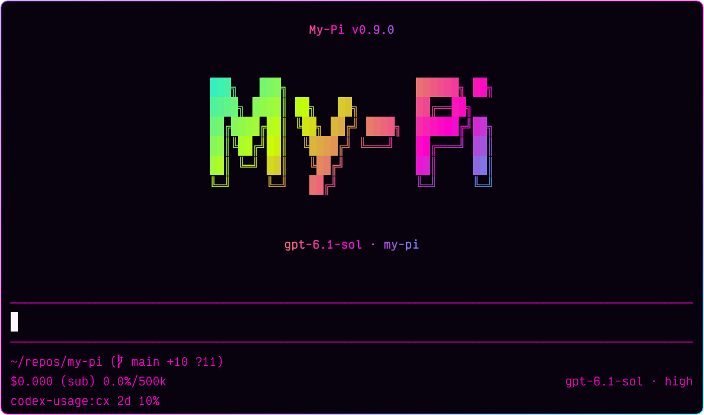

# @spences10/pi-redact

<!-- package-readme:header:start -->

[](https://viteplus.dev)
[](https://vitest.dev)
[](https://www.npmjs.com/package/@spences10/pi-redact)
[](https://www.npmjs.com/package/@spences10/pi-redact)



<!-- package-readme:header:end -->

Mask likely secrets and explicitly registered values before output
reaches model context. This is a safety net for accidental exposure,
not a perfect secret detector or a shell sandbox.

## Installation

<!-- package-readme:install:start -->

```bash
pi install npm:@spences10/pi-redact
```

<!-- package-readme:install:end -->

Local development from this monorepo:

```bash
pnpm --filter @spences10/pi-redact run build
pi install ./packages/pi-redact
# or for one run only
pi -e ./packages/pi-redact
```

`my-pi` includes this package. Custom SDK harnesses can pass its
default export as an `ExtensionFactory`.

## Detection

The matcher combines:

- distinctive provider formats, including GitHub, GitLab, Slack, npm,
  Google, AWS, Stripe, OpenAI/Anthropic, SendGrid and JWT tokens
- contextual credential fields in JSON, environment/config
  assignments, authorization headers and credential-bearing connection
  URLs
- private-key blocks and header-bearing fragments
- SSH config metadata such as `HostName`, `User`, `IdentityFile`,
  `ProxyJump` and forwarding directives
- explicitly registered exact values, including their JSON-escaped,
  percent-encoded, base64 and base64url forms in textual output

Markers identify the match, for example `[REDACTED:GitHub Token]`.
Matched credentials are replaced entirely; contextual labels and URL
schemes remain where applicable. Ordinary code expressions and
unlabelled high-entropy output are not treated as credentials merely
for looking random.

## Filtering boundaries

- `tool_result` masks final text, nested string leaves in `details`
  and `structuredContent`, and tokens split across adjacent text
  blocks. Objects, non-string values and binary payload bytes are
  preserved.
- `user_bash` wraps Pi's local shell backend. `!` and `!!` output is
  decoded incrementally and terminal controls are removed before
  matching. Safe complete lines stream while the command runs;
  incomplete lines, registered-value prefixes and ambiguous PEM/SSH
  context wait for enough evidence or command completion. Callbacks,
  saved output and Pi's truncation files receive sanitized bytes.
  UTF-8, escape sequences and registered multiline values can cross
  arbitrary chunks. Exit codes, cancellation and shell settings remain
  Pi's responsibility.
- `message_end` masks finalized message text before the normal agent
  loop persists it. Executable tool-call arguments and protocol IDs
  are not changed.
- `context` and `context_with_system` sanitize request copies,
  including user/custom text, old shell commands/output, summaries and
  historical tool arguments. A bounded content-keyed cache works
  across Pi's cloned messages and is invalidated on exact-value
  registration.
- `session_before_compact` and `session_before_tree` sanitize cloned
  preparation messages and entries used by the default summarizers.
  They do not replace Pi's authentication, model selection or summary
  implementation, and do not rewrite raw history.

A `tool_call` source check blocks local `read` targets beginning with
a private-key header and plausible key payload, even for a first read
starting mid-file or through a path alias. Replacing the key file with
ordinary content does not leave that path permanently blocked. There
is no general filename denylist or credential-store scanning.

After a masked `read`, a `write` to that same file is blocked when it
would introduce an observed redaction marker absent on disk, or when
the current file cannot be checked. This prevents copying a masked
view back over credentials. It does not reject unrelated new files or
intentional markers already present on disk. Prefer targeted edits
that leave the masked value alone. An `edit` using masked text as its
exact old text normally fails to match the real file.

## Register exact values from trusted code

Register values you already possess through Pi's in-memory event bus,
not a model-visible tool, prompt, command argument or transcript:

```ts
import type { ExtensionAPI } from '@earendil-works/pi-coding-agent';

export function register_secrets(pi: ExtensionAPI, values: string[]) {
	pi.events.emit('pi-redact:register-secrets', { values });
}
```

Load `pi-redact` before the extension that emits this event. The
payload must contain an array of strings; malformed registrations are
ignored and empty strings are skipped. Values are deduplicated, held
only in that runtime's memory, and cleared on session shutdown/reload.
Register again for a new runtime. No credential store, environment or
directory is scanned. Register before producing output; already
emitted text cannot be retroactively masked.

Standalone callers can supply values without an extension runtime:

```ts
import { redact_text } from '@spences10/pi-redact';

const result = redact_text(output, { known_values: values });
// result.redacted and result.count
```

The existing `looks_like_ssh_config` and `redact_ssh_config_metadata`
helpers remain exported. `redact_text` also accepts `force_ssh_config`
and `force_private_key`; the latter masks plausible key-payload lines,
not every line of arbitrary text.

## Commands

### `/redact-stats`

Shows matched replacements scanned in the current runtime. Cached text
is not counted again; evicted text can be counted again if rescanned.
This is a diagnostic counter, not a count of unique secrets or proof
that every secret was removed.

## Limitations

Coverage is tested against Pi 1.5.2 using an offline SDK transport,
including normal turns, default compaction and default tree summaries.
Important boundaries remain:

- Unknown arbitrary passwords, novel formats, unregistered encodings
  and unrelated chunks can be missed. Unlabelled high-entropy text is
  not blanket-masked, and false positives remain possible.
- Final tool-result filtering does not protect earlier tool progress
  events, tool-owned logs/files or an earlier extension's observers.
  Direct-shell filtering applies only when this `user_bash` handler
  owns execution. Load safety/confirmation `user_bash` handlers before
  `pi-redact`: its operations result stops all later handlers. An
  earlier SSH or other custom-backend handler can instead intercept
  first and bypass this local wrapper; a later backend handler will
  not run. Direct SDK `executeBash()` calls must use the hook's
  operations to get the same protection.
- Streaming is conditional, not byte-by-byte. A long unfinished line,
  a long registered prefix, or an unconfirmed SSH/PEM candidate can
  delay following output and consume memory until resolved or EOF. SSH
  directives before `Host` are retained rather than emitted raw;
  unmatched candidates are released unchanged apart from other secret
  matches. Exact and pattern detections use original-text spans so
  overlapping matches do not expose suffixes or erase neighboring
  context. Terminal-control payloads, including unfinished escapes at
  EOF, are not displayed.
- Pi still records the original direct-shell **command string**. Do
  not put secrets in commands. Request and summary fallbacks mask
  copies, not the saved command. The original command still executes.
- Previously saved history remains raw. Immediate custom-message
  appends (`triggerTurn: false`), direct `recordBashResult()` and
  direct session-manager writes bypass the pre-persistence hook. Their
  text is protected only when it later passes through request or
  summary preparation hooks. Other extensions can still read raw
  entries.
- Compaction and branch summaries bypass normal context/provider
  hooks. Preparation filtering protects their history inputs, but
  compaction's separately supplied custom instructions and newly
  generated summary output have no equivalent pre-persistence
  transform here. Do not supply secrets in compaction instructions.
- Binary/image bytes, opaque provider signatures, protocol metadata
  and live tool-call arguments are intentionally preserved. This is
  not OCR, a filesystem guard for arbitrary shell commands or a
  universal filter for auxiliary provider requests. The private-key
  source check inspects only the first 2 KiB of a requested local
  file; overridden remote reads and concurrent file replacement can
  bypass that source check.

Use proper secret hygiene as the primary control: avoid printing or
encoding secrets, prefer `nopeek` to loading `.env` files into model
context, use scoped revocable tokens, and rotate exposed credentials.

## Development

<!-- package-readme:development:start commands="check,test,build" -->

Package scripts build transitive workspace dependencies first, then
run local tools through Vite+ with `vp exec`.

```bash
pnpm --filter @spences10/pi-redact run check
pnpm --filter @spences10/pi-redact run test
pnpm --filter @spences10/pi-redact run build
```

<!-- package-readme:development:end -->

## License

MIT
